<p align="center">
    
</p>

<p align="center">
    <strong>AI-Powered Automated Cybersecurity Threat Detection Platform</strong>
</p>

<p align="center">
    <a href="https://thalesgroup-cert.github.io/Watcher/guide/install-watcher/launch-watcher/">
        
    </a>
    <a href="https://thalesgroup-cert.github.io/Watcher/">
        
    </a>
    <a href="https://github.com/thalesgroup-cert/Watcher">
        
    </a>
    <a href="https://github.com/thalesgroup-cert/Watcher/issues?q=is%3Aissue+is%3Aclosed">
        
    </a>
    <a href="./LICENSE">
        
    </a>
    <a href="https://hub.docker.com/r/felix83000/watcher/tags">
        
    </a>
</p>

<p align="center">
    <a href="https://trendshift.io/repositories/15680?utm_source=repository-badge&utm_medium=badge&utm_campaign=badge-repository-15680" target="_blank" rel="noopener noreferrer">
        
    </a>
    <a href="https://trendshift.io/repositories/15680?utm_source=trendshift-badge&utm_medium=badge&utm_campaign=badge-trendshift-15680" target="_blank" rel="noopener noreferrer">
        
    </a>
</p>

Watcher is a Django & React JS platform designed to discover and monitor emerging cybersecurity threats with **AI-powered threat intelligence analysis**. It can be deployed on webservers or quickly run via Docker.

<p align="center">
    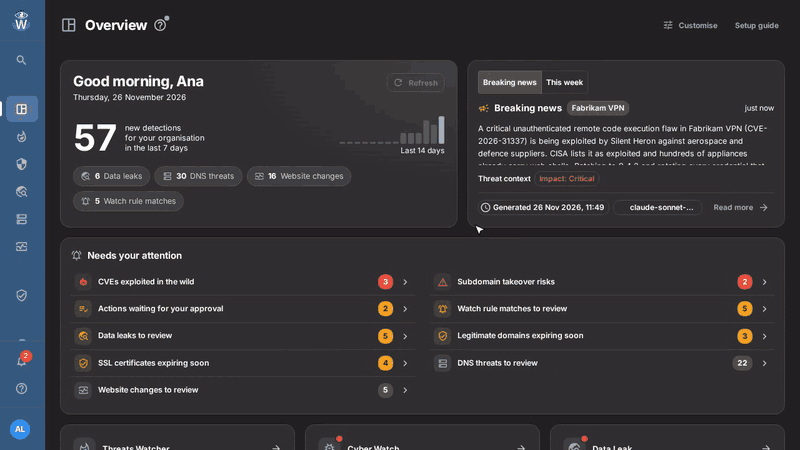
</p>

## Watcher Capabilities

Watcher empowers your security operations with comprehensive threat detection and monitoring:

- **AI-Driven Threat Intelligence** - Transform raw threat data into actionable intelligence with the LLM of your choice (OpenAI, Anthropic, Gemini, Ollama or any endpoint supported by LiteLLM), with a default AI, a fallback on the others and on a local model. Get a weekly report clustering the top threats by severity and citing the sites it relies on, breaking news with impact level, targeted sectors, threat actors and CVEs, and on-demand summaries for any security keyword. Any summary can be regenerated on demand.

- **CVE & Ransomware Intelligence** - Continuously fetch, correlate, and surface external threat data: CVEs from [cve.circl.lu](https://cve.circl.lu) flagged when **exploited in the wild** (CISA KEV) and scored by **EPSS**, ransomware victims and groups from [ransomware.live](https://ransomware.live) and [ransomlook.io](https://ransomlook.io). Define keyword-based Watch Rules to get alerted when specific threats match your organisation's context, with one match per rule and object.

- **Emerging Threat Detection** - Monitor cybersecurity trends via RSS feeds from CERT-FR (www.cert.ssi.gouv.fr), CERT-EU (www.cert.europa.eu), US-CERT (www.us-cert.gov), Australian Cyber Security Centre (www.cyber.gov.au), and more. See which words jump (Hot, Rising, New, Steady, Fading), follow keyword rules (all of / one of / none of) and track new vulnerabilities, malware campaigns, and threat advisories as they appear.

- **Legitimate Domain Management** - Centralized approved domains with expiry dates read from the registries (with guards against false alarms), SSL certificates, repurchase status, registrar info, and contacts. A domain the registry no longer knows is sent to **Pending actions** for a decision. Easily convert monitored malicious domains into legitimate ones. Automated UDRP case tracking.

- **Information Leak Monitoring** - Detect sensitive data exposure across the webs including Pastebin, StackOverflow, GitHub, GitLab, Bitbucket, APKMirror, npm registries, and other platforms. Catch leaked credentials, API keys, and confidential information early, with a screenshot of the page.

- **Malicious Domain Surveillance** - Monitor malicious domains for changes in IP addresses, mail/MX records, and web content. Use [TLSH](https://github.com/trendmicro/tlsh) fuzzy hashing to detect modifications. Follow precise web pages: the text is versioned, the change is shown as a diff and notified above a threshold, with a screenshot of each version. Automatic RDAP checks with registrar and expiry alerts.

- **Suspicious Domain Detection** - Identify potentially malicious domains targeting your organisation via:
  - **Domain Generation Algorithm Detection** using [dnstwist](https://github.com/elceef/dnstwist) to find typosquatting, homograph attacks, and similar domain variants
  - **Certificate Transparency Monitoring** via [certstream](https://github.com/CaliDog/certstream-python) to catch newly registered suspicious domains in real-time

## Additional Features

Extend Watcher's capabilities with powerful integrations and management tools:

- **TheHive Full Synchronization** - Integration with [TheHive](https://thehive-project.org/) featuring automated alert creation, smart case management, IOC enrichment, and ready-to-use Cortex Analyzers & Responders. Detailed configuration are provided in the documentation [here.](https://thalesgroup-cert.github.io/Watcher/guide/install-watcher/launch-watcher/#thehive-export)
- **MISP Integration** - Seamlessly export Indicators of Compromise (IOCs) to [MISP](https://www.misp-project.org/) with smart UUID tracking, automatic object creation, and manual attribute updates for collaborative threat intelligence sharing
- **SSO / OpenID Connect** - Federated login via any OIDC provider (Keycloak, Azure AD, etc.) with PKCE and Knox token issuance. Configurable per-instance via `.env`
- **Bulk Add & Bulk Actions** - Add many items at once with the *One item per line* toggle or from a `.txt` / `.csv` file (with a no-write Preview and a per-item created / skipped / error summary, and an **Undo this import**), or tick rows in any table to edit, delete or export them (to Legitimate Domains or MISP) in one go
- **Flexible Authentication** - Support for LDAP, local, and SSO/OIDC authentication systems. The session token of the browser is kept in an `httpOnly` cookie, never in a place a script of the page can read
- **Connectors Dashboard** - A superuser-only `/connectors` page to view, edit, and test every external integration (SMTP, Slack, Citadel, TheHive, MISP, CyberWatch feeds, LLM providers, and more) from one place, with encrypted credential storage, per-connector health checks, a **Deliveries** journal of what each connector did, a page of **scheduled jobs**, and a one-click **Default AI** selection.
- **Smart Notifications** - A catalog of 22 notifications, each switched on per channel (email, Slack, Citadel, TheHive) by a superuser in **Connectors > Notifications**, with messages you can edit: critical findings and threshold violations across all modules including CyberWatch, exploited CVEs, domain expiry and UDRP decisions, with dedicated layouts for the weekly report and breaking news
- **Interactive API Documentation** - Auto-generated Swagger UI at `/api/docs/` and OpenAPI 3 schema at `/api/schema/` powered by drf-spectacular
- **Ticketing System Integration** - Automatically feed your ticketing system with security findings
- **Comprehensive Admin Interface** - Manage all aspects of Watcher through Django's powerful admin panel
- **Advanced Access Control** - Granular user permissions and group management for team collaboration
- **Modern UI Experience** - A new interface with an **Overview** home page, 13 themes (light, dark, glass effects, high contrast), global search (<kbd>Ctrl</kbd>+<kbd>K</kbd>), filters and sort kept in the address, row density and text size settings, an optional typewriter effect for AI summaries, and persistent user preferences

## Involved dependencies

Watcher leverages open source tools and libraries:
- [**LiteLLM**](https://github.com/BerriAI/litellm) - Unified gateway to the LLM providers powering threat intelligence summaries and entity extraction
- [**Hugging Face Transformers**](https://huggingface.co/docs/transformers) - Local models used as a fallback when no LLM provider is available
- [**dslim/bert-base-NER**](https://huggingface.co/dslim/bert-base-NER) - Local Named Entity Recognition fallback for automatic IOC extraction
- [**certstream**](https://github.com/CaliDog/certstream-python) - Certificate Transparency monitoring
- [**dnstwist**](https://github.com/elceef/dnstwist) - Domain name permutation engine
- [**SearxNG**](https://github.com/searxng/searxng) - Privacy-respecting metasearch engine
- [**PyMISP**](https://github.com/MISP/PyMISP) - MISP threat intelligence platform integration
- [**TLSH**](https://github.com/trendmicro/tlsh) - Fuzzy hashing for content similarity detection
- [**mozilla-django-oidc**](https://github.com/mozilla/mozilla-django-oidc) - OpenID Connect authentication backend
- [**drf-spectacular**](https://github.com/tfranzel/drf-spectacular) - OpenAPI 3 schema generation and Swagger UI
- [**react-simple-maps**](https://www.react-simple-maps.io/) - World map of the ransomware victims and of the sources
- [**MUI (Material UI)**](https://mui.com/) - React component library for KPI cards and charts
- [**Playwright**](https://playwright.dev/) - Headless browser of the screenshotter, in its own isolated container
- [**NLTK**](https://www.nltk.org/) - Natural Language Toolkit for text processing

## App Preview

All the screenshots below use fictional data (a made-up company, "Altair Dynamics").

### Overview
<p align="center">
    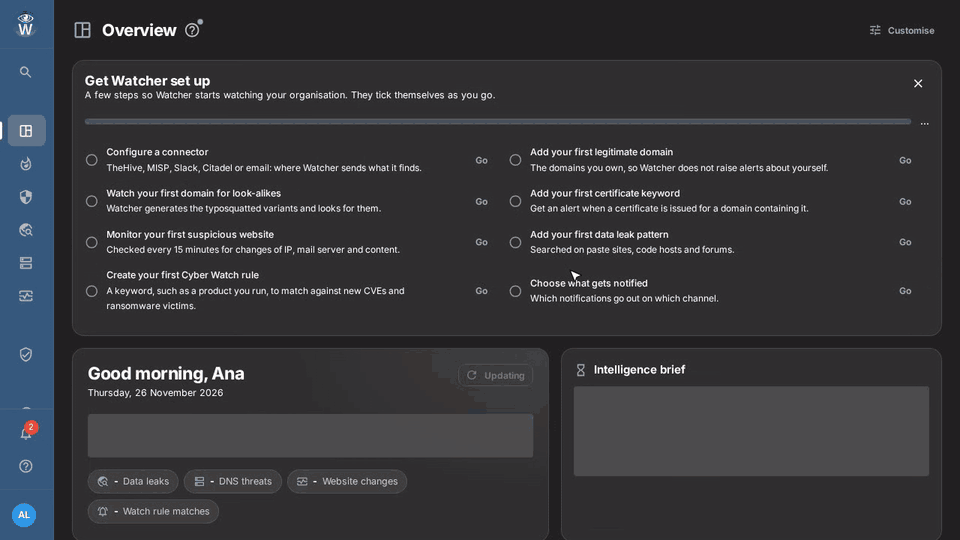
</p>

The home page: the week in one figure, the AI brief, what needs your attention, a card per module, the latest detections, the top vulnerabilities and the trending words. **Customise** chooses the blocks.

### Threat Detection
<p align="center">
    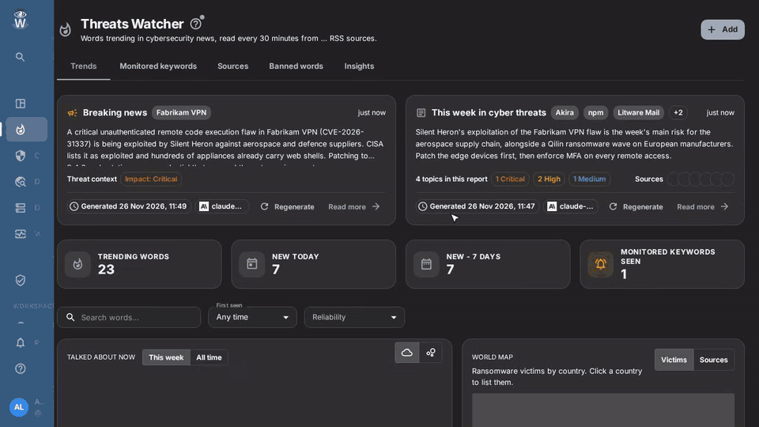
</p>

The words that jump come first, with their reliability and a chart of their week; a click opens the articles by day, the summary of the word and the CVEs it mentions.

### AI-Powered Weekly Summary & Breaking News
<p align="center">
    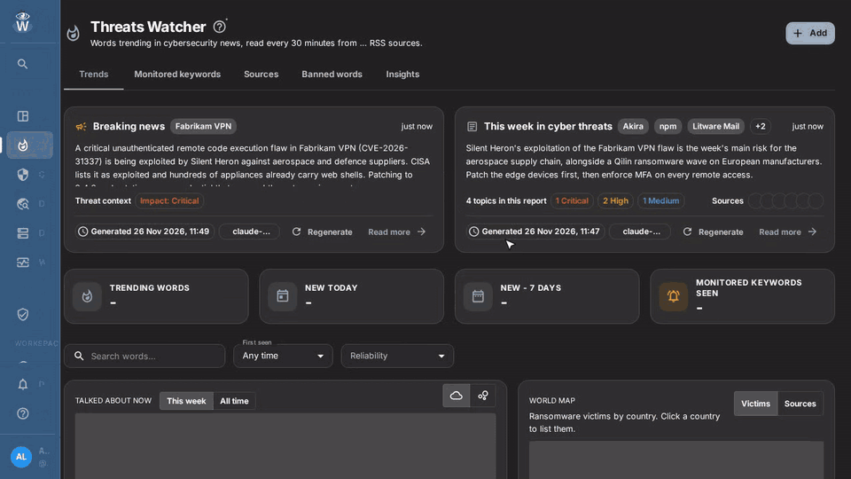
</p>

The weekly report by cluster of severity, with the sites it relies on, and the breaking news that stays for 24 hours. Both can be written again with **Regenerate**.

### Suspicious domain names detection
<p align="center">
    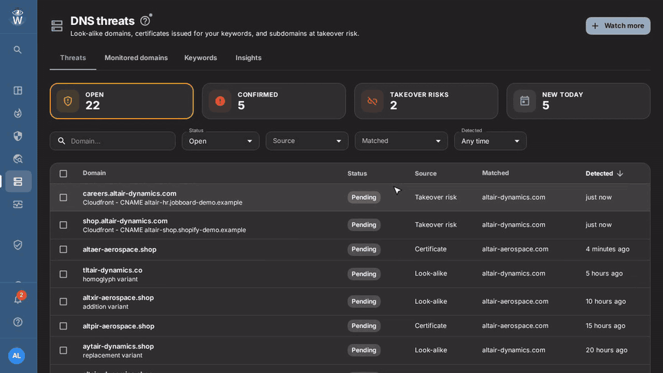
</p>


### Legitimate Domain List
<p align="center">
    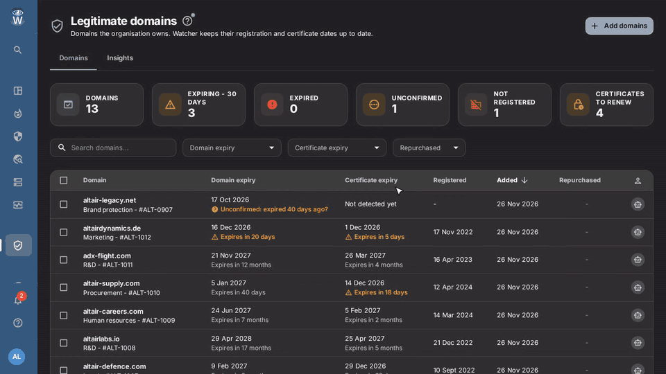
</p>

Add several domains in one go with the *One item per line* toggle or from a file: defanged links are restored, a *Preview* shows the result before anything is saved, and the summary lists every domain as created, skipped or in error, with an **Undo this import**.

### Data Leak Detection
<p align="center">
    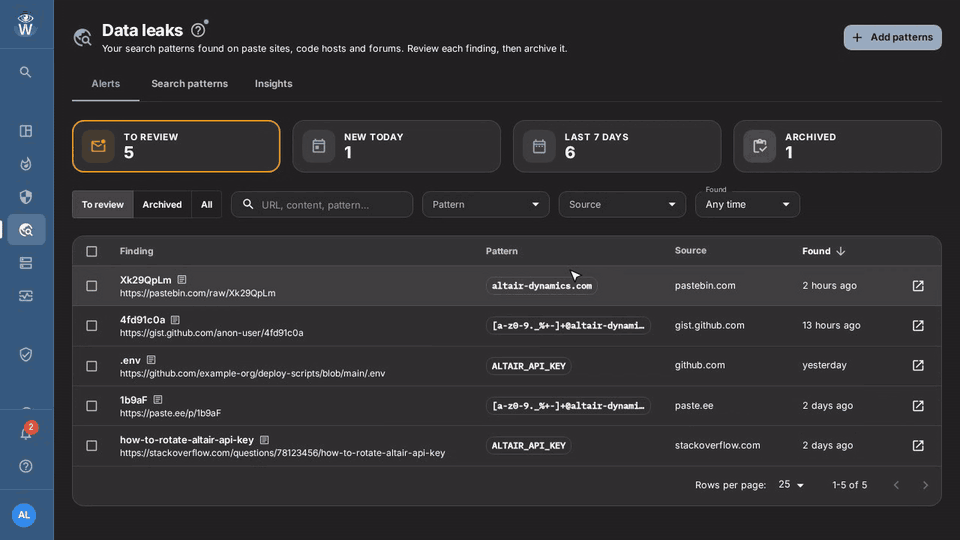
</p>


### Suspicious domain names monitoring
<p align="center">
    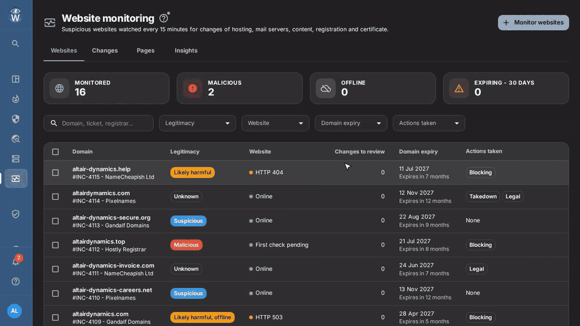
</p>

Select several domains and change legitimacy, takedown, legal and blocking flags together. Pages can be followed too: each change is a version with its diff and its screenshot.

### Bulk actions and exports
<p align="center">
    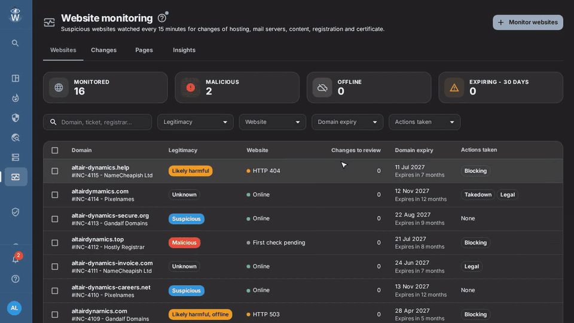
</p>

False positives can be exported to Legitimate Domains in bulk: the exported sites disappear from Website Monitoring and appear in the legitimate list, with no page refresh.

### Cyber Watch
<p align="center">
    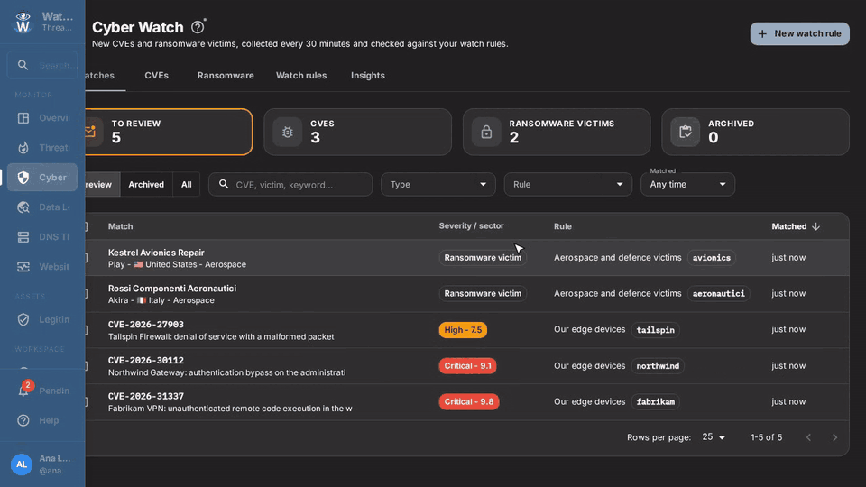
</p>

CVEs flagged when exploited in the wild, with their EPSS score, ransomware victims and groups, and the watch rules with the matches they produce.

### Notifications and connectors
<p align="center">
    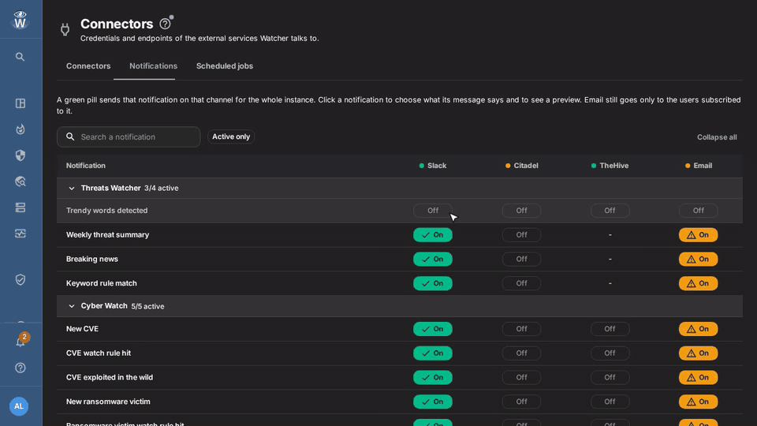
</p>

Every notification is switched on per channel with one pill, and every connector shows its health and what it delivered.

### History of every change
<p align="center">
    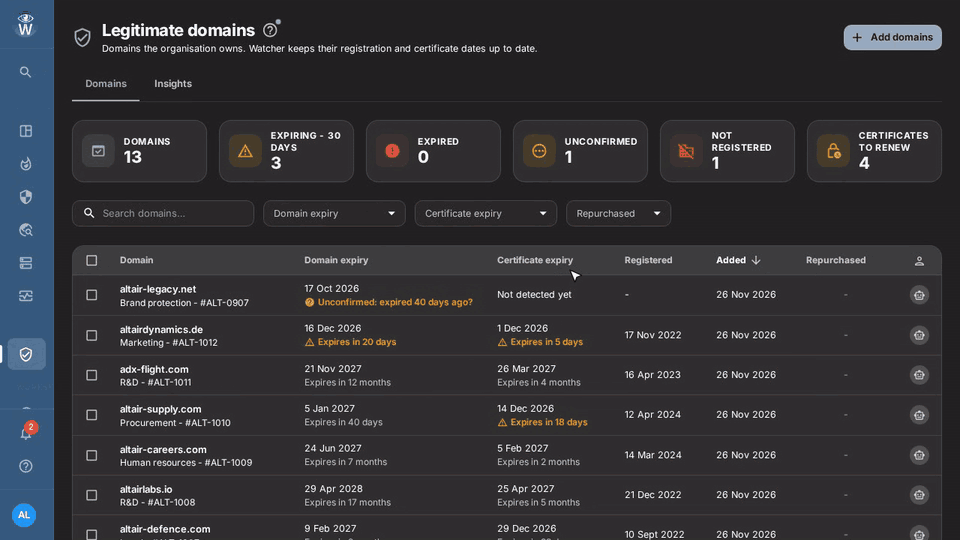
</p>

Every create, update and delete is recorded with its author, so you can see who changed what and when.

### Theme Previews
<p align="center">
    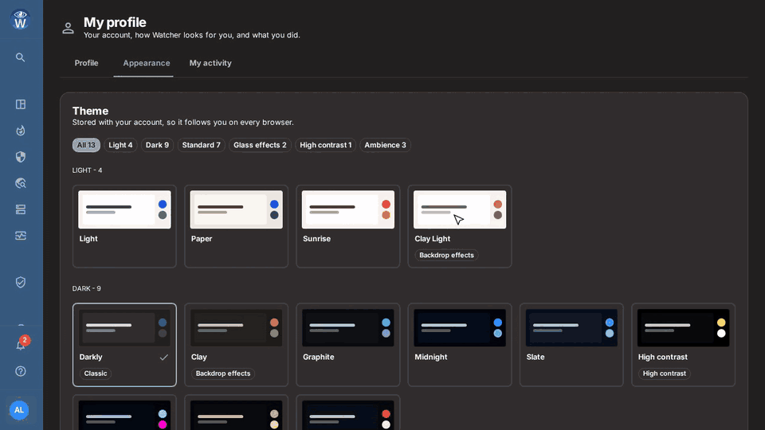
</p>

Watcher offers 13 themes, from light to dark, with glass effects and a high contrast one, to match your preferences and working environment.

### Admin Interface
<p align="center">
    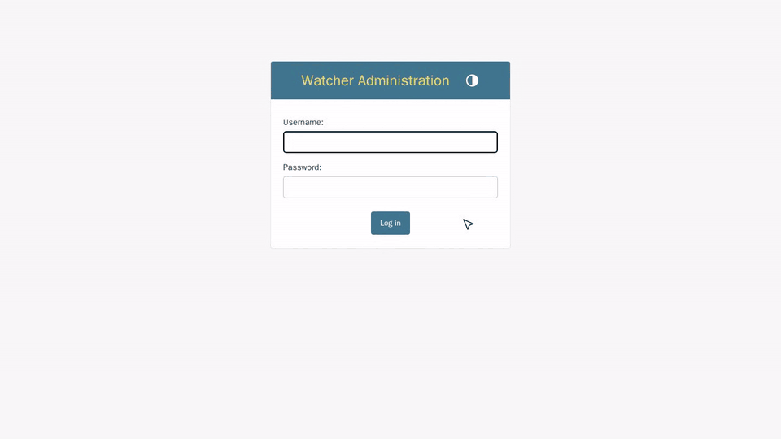
</p>

Django provides a ready-to-use user interface for administrative activities: users and groups, API keys, and the data of every module, with filters and search on each page.

## Installation

```bash
# 1. Clone the repo
git clone https://github.com/thalesgroup-cert/watcher.git
cd watcher/deployment

# 2. Initialize environment, configs & directory structure
make init

# 3. Start the stack
make up

# 4. On first run: run database migrations + create superuser
make migrate
make superuser
make populate-db

# 5. Open the web UI
#    http://localhost:9020  (or your configured domain/port)
```

Get Watcher up and running in just **10 minutes** using Docker. **Detailed instructions available in our [Installation Guide](https://thalesgroup-cert.github.io/Watcher/guide/install-watcher/launch-watcher/)**

## Platform Architecture

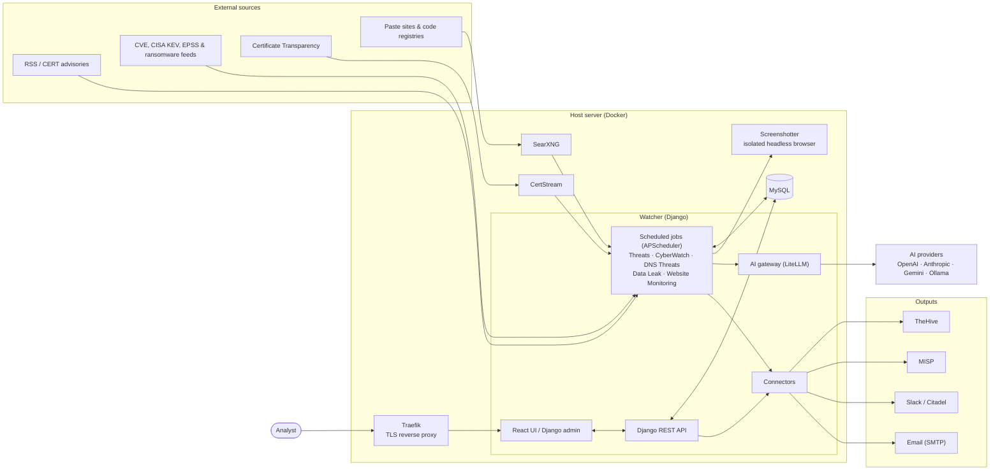

Watcher's modular architecture ensures scalability, reliability, and easy integration with your existing security stack. Everything runs in one Django process, scheduler included: no Celery, no Redis.

## Contributing

We welcome contributions from the security community!

To report bugs, request features, or submit code, please read our full [Contributing Guide](CONTRIBUTING.md), then open an [issue](https://github.com/thalesgroup-cert/Watcher/issues/new/choose) or a pull request (to the `test` branch). Security vulnerabilities go through [GitHub Security Advisories](https://github.com/thalesgroup-cert/Watcher/security/advisories/new), not a public issue.

## Pastebin Compliance

In order to use Watcher pastebin API feature, you need to subscribe to a pastebin pro account and whitelist Watcher public IP (see https://pastebin.com/doc_scraping_api).

